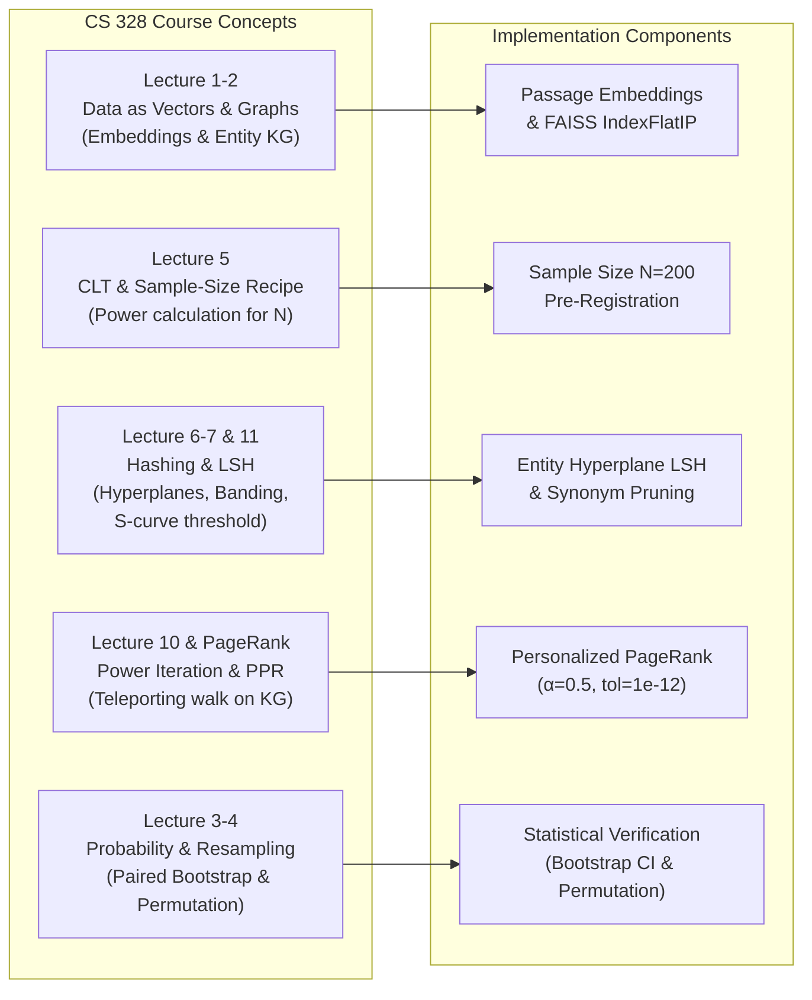
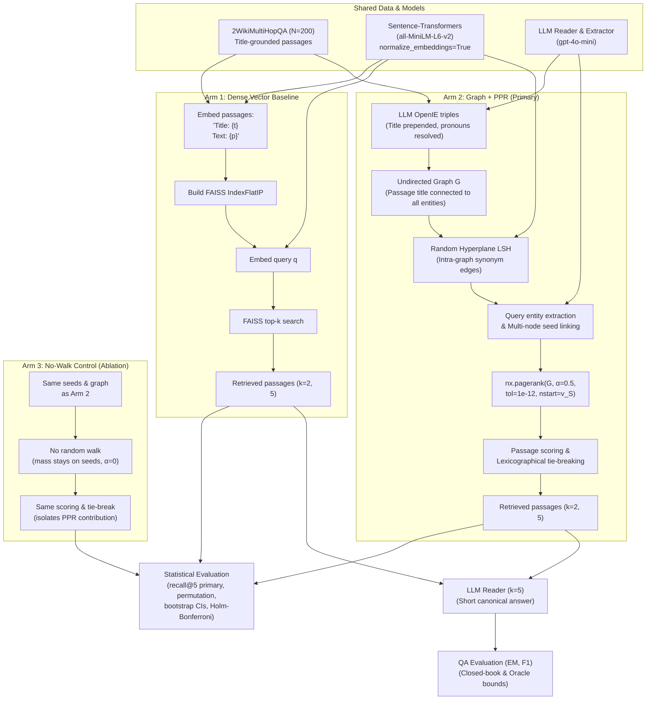
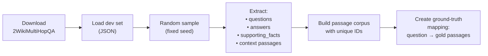
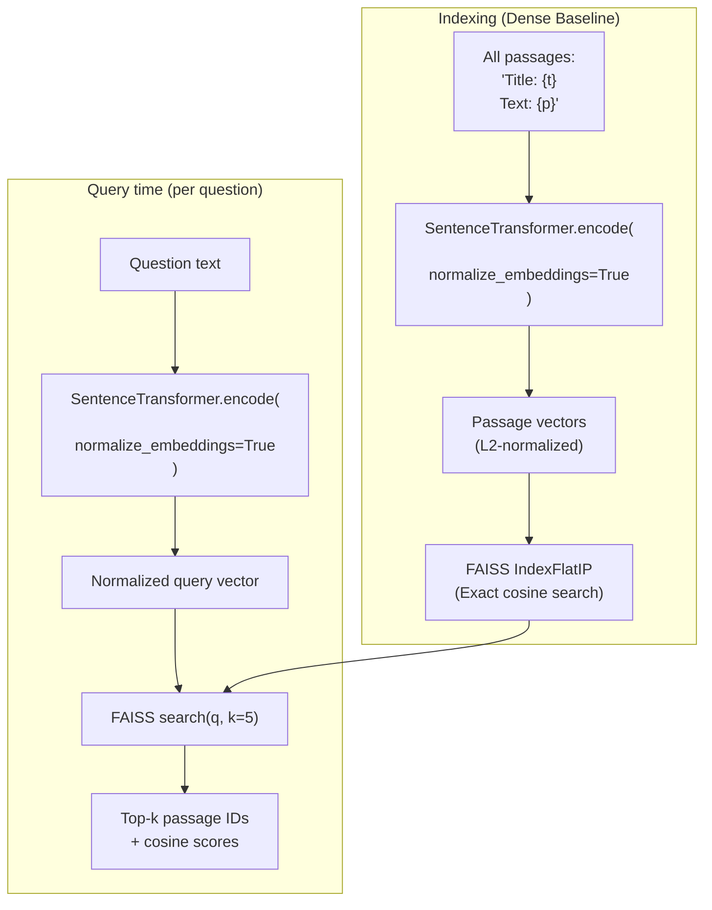
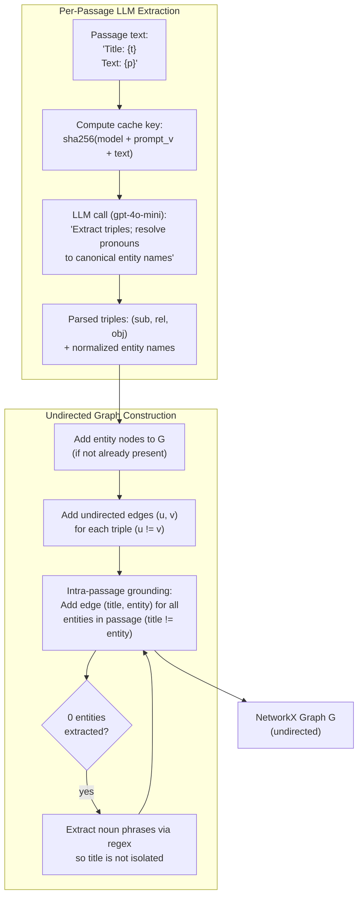
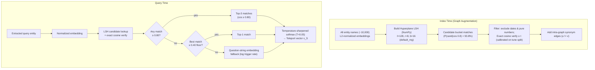
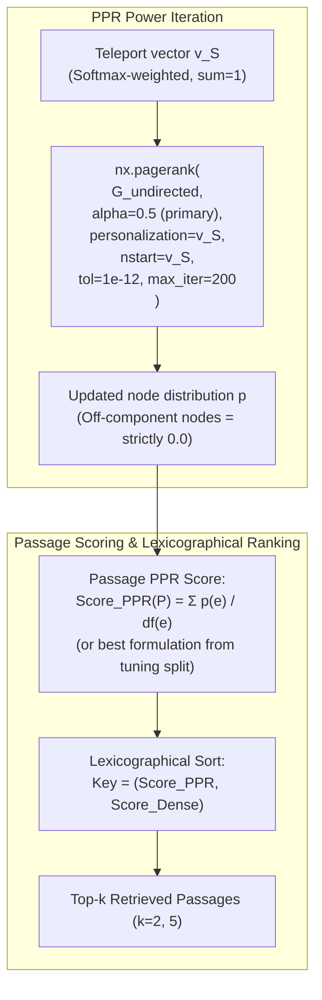
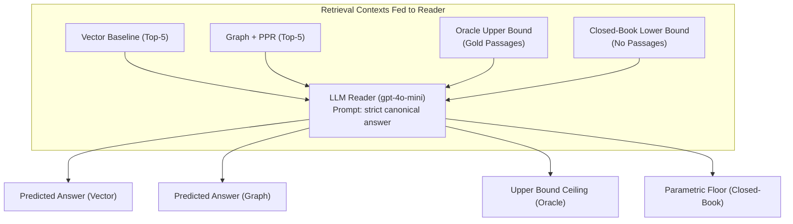
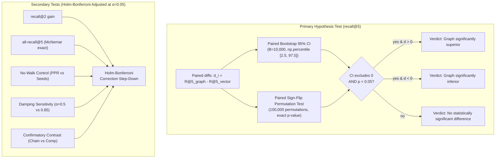

# 📋 Implementation Plan: Graph-Based Retrieval vs Vector Search on Multi-Hop Questions

> **Course**: CS 328 — Introduction to Data Science
> **Author**: Chitiveli Hemcharan Varma
> **Project Title**: *Does Graph-Based Retrieval Beat Vector Search on Multi-Hop Questions? A HippoRAG-style Study Using Personalized PageRank*

---

## 1. Project Overview & Research Question

### 1.1 The Core Idea (Simple Explanation)

In **Retrieval-Augmented Generation (RAG)**, when a user asks a question, we first *retrieve* relevant passages from a corpus, then feed them to an LLM to generate an answer.

**The problem**: Standard vector search (embed question → find nearest passages) treats each passage *independently*. For **multi-hop questions** — questions that need information from *two or more* passages connected through a shared entity — vector search can miss the second-hop passage because it isn't directly similar to the question.

**The proposed fix (HippoRAG-style)**: Build an **entity graph** from the passages (entities are nodes, relationships are edges). At query time, find the query's entities in the graph, run **Personalized PageRank (PPR)** from those nodes, and retrieve passages associated with the highest-ranked nodes. The graph structure should naturally "walk" from the first-hop entity to the second-hop entity.

### 1.2 Research Questions

| ID | Question |
|----|----------|
| **RQ1** | Does Graph + PPR achieve higher **recall@2** and **recall@5** than a dense-vector baseline? |
| **RQ2** | With the same LLM reader, does the better retriever also achieve higher **Exact Match (EM)** and **F1**? |

### 1.3 Hypotheses & Pre-Registered Decision Protocol

| | Statement |
|------|-----------|
| **H₁ (Primary)** | Graph + PPR achieves higher retrieval **recall@5** than the dense-vector baseline on multi-hop questions. |
| **H₁ (Sub-Claim)** | The recall gain of Graph + PPR is larger on relational chain questions (`compositional` + `inference`) than on direct `comparison` questions (which name both entities in the query). |
| **H₀** | There is no difference in retrieval recall between the two methods ($\Delta = 0$). |

> [!IMPORTANT]
> **Pre-Registered Verdict Rule**:
> 1. **Primary Metric**: **recall@5** is the pre-registered primary decision metric.
> 2. **Decision Criterion**: Graph + PPR is declared significantly better if and only if:
>    - The mean recall gain is positive: $\Delta = \bar{X}_{\text{Graph}} - \bar{X}_{\text{Vector}} > 0$, **AND**
>    - The paired 95% Bootstrap Confidence Interval for the mean difference excludes zero ($L > 0$), **AND**
>    - The paired sign-flip permutation test on the mean difference is significant at $\alpha = 0.05$ ($p < 0.05$).
> 3. **Three-Way Outcome Logic**:
>    - **Graph Significantly Better**: $\Delta > 0$, CI lower bound $> 0$, and permutation $p < 0.05$.
>    - **Graph Significantly Worse**: $\Delta < 0$, CI upper bound $< 0$, and permutation $p < 0.05$.
>    - **No Clear Difference**: 95% CI contains 0 or permutation $p \ge 0.05$. We report results objectively either way.
> 4. **Multiplicity Control**: Secondary metrics (`recall@2`, `all-recall@5`, no-walk control, $\alpha=0.85$ sensitivity) are adjusted for family-wise error rate using the **Holm-Bonferroni method** at $\alpha = 0.05$.

---

## 2. Course Concepts Mapping

This project directly operationalizes the core concepts from CS 328:



| Lecture | Core Theory | Implementation in Project |
|---------|-------------|---------------------------|
| **Lec 1-2**: Data as Vectors, Sets & Graphs | High-dimensional feature representation; graph adjacency | Passages and entities mapped to normalized dense embedding vectors; extracted relations form an undirected knowledge graph $G = (V, E)$. |
| **Lec 3-4**: Probability & Resampling | Empirical distributions, expectation, paired differences | 1-sample bootstrap for individual error bars (`bootstrap_mean_ci`); paired bootstrap (`bootstrap_diff_ci`) and sign-flip permutation tests for mean recall difference. |
| **Lec 5**: CLT & Sample-Size Arithmetic | Sample-size recipe: $n \ge \frac{z^2 \sigma^2}{\epsilon^2}$ | Statistically justifies fixed sample size $N = 200$ (with $\sigma^2 \le 0.25$, $\epsilon = 0.07$, $z_{0.025} = 1.96$). |
| **Lec 6-7**: Hashing & LSH | Random projections, signature banding, S-curve inflection | Banding scheme ($b=16, r=8$) groups entity embeddings into candidate buckets to prune $\mathcal{O}(|V|^2)$ pairwise comparisons. |
| **Lec 10**: Power Iteration | Dominant eigenvector computation: $p_{t+1} = G p_t$ | Personalized PageRank executes power iteration on the Google matrix with teleportation restricted to query entity seeds. |
| **Lec 11**: Vector Search & Hyperplane LSH | Angle-to-probability mapping: $p = 1 - \theta/\pi$; Cosine search | Dense baseline uses normalized inner-product search (`IndexFlatIP`); Entity linker uses Random Hyperplane LSH with exact cosine verification. |
| **PageRank Lecture**: Random Walks & PPR | Teleporting walk, contraction lemma, stationary distribution $\pi$ | Primary retrieval arm runs PPR ($\alpha = 0.5$, $\text{tol} = 10^{-12}$, $\text{nstart} = v_S$) from query entities to discover multi-hop evidence. |

---

## 3. Dataset & Sampling Strategy

### 3.1 2WikiMultiHopQA

- **Dataset**: 2WikiMultiHopQA ([Ho et al., COLING 2020](https://github.com/Alab-NII/2wikimultihop)).
- **Why this dataset**: Multi-hop questions with annotated sentence-level supporting facts and a distractors-rich corpus (~10 context passages per question).
- **Question Types in 2Wiki**:
  1. `compositional`: 2-hop relational chain (e.g., "Who is the mother of the director of X?") $\implies$ **2 supporting passages**.
  2. `inference`: 2-hop inferential chain $\implies$ **2 supporting passages**.
  3. `comparison`: Direct comparison between two query-named entities $\implies$ **2 supporting passages**.
  4. `bridge_comparison`: Bridges two separate entities and compares their attributes $\implies$ **4 supporting passages**.

### 3.2 Two Disjoint Splits (Preventing Evaluation Data Snooping)

To strictly follow pre-registration principles and avoid tuning hyperparameters on test data:

1. **Hyperparameter Tuning Split ($N_{\text{tune}} = 100$ questions)**:
   - Sampled independently with `seed=101`.
   - Used exclusively to calibrate the LSH candidate threshold $\tau$, compare passage scoring formulations, and audit synonym edge precision.
   - Built with its own separate passage corpus to avoid changing graph hub density on the test set.
2. **Final Evaluation Split ($N = 200$ questions)**:
   - Sampled with `seed=42`, stratified across the 4 question types proportional to their distribution in the 2Wiki development set.
   - All parameters in `config.py` are **frozen** before running any experiment on this split.
   - Results are reported per stratum and as a dev-proportion-weighted overall mean.

### 3.3 Sample Size Arithmetic (Lecture 5 CLT Recipe)

From Lecture 5 ("Sample-Size Arithmetic", slide 10), the sample size required to estimate an average to within margin $\epsilon$ at confidence $1 - \delta$ satisfies:
$$n \ge \frac{z_{\delta/2}^2 \cdot \sigma^2}{\epsilon^2}$$
For retrieval recall differences $\Delta_i \in [-1, 1]$, the maximum possible variance is $\sigma^2 \le 0.25$. At $95\%$ confidence ($z_{0.025} = 1.96$) with a targeted margin of error $\epsilon = 0.07$:
$$n \ge \frac{(1.96)^2 \times 0.25}{(0.07)^2} \approx \frac{0.9604}{0.0049} \approx 196 \implies \mathbf{N = 200}$$
Thus, fixing $N = 200$ evaluation questions is mathematically justified by the Lecture 5 sample-size recipe.

---

## 4. System Architecture

### 4.1 High-Level Architecture



### 4.2 Fair Comparison Guarantees & Compute Transparency

1. **Input Symmetry (Strict Equity)**:
   - Both methods receive the exact same passage representation: `f"Title: {title}\nText: {passage_text}"`.
   - In 2WikiMultiHopQA, the title is often the *only* place the subject entity is named (body sentences frequently begin with pronouns). Feeding the title to both arms ensures the dense vector search is not artificially handicapped.
   - `all-MiniLM-L6-v2` truncates inputs at 256 tokens; we log the percentage of passages truncated.
2. **Shared Controls**: Same passage corpus, same embedding model, same LLM reader, same question set, and same top-$k$ cutoffs ($k=2, 5$).
3. **Compute Asymmetry (Transparent Disclosure)**:
   - **Dense Baseline**: 1 encoding pass over passages ($\mathcal{O}(|P|)$) and 1 query encode + inner product per question ($\mathcal{O}(|P| \cdot d)$).
   - **Graph + PPR**: Requires offline LLM triple extraction ($\mathcal{O}(|P|)$ API calls), entity embedding + LSH candidate search ($\mathcal{O}(|V|)$), query NER LLM calls, and sparse power-iteration random walks ($\mathcal{O}(m \cdot t)$). This compute investment is acknowledged as the trade-off for multi-hop graph exploration.

---

## 5. Implementation Flow — Step by Step

### Phase 0: Project Setup

```
ids_project/
├── IDS_Proposal.pdf
├── ids/                          # lecture slides
├── data/
│   └── 2wikimultihopqa/          # downloaded dataset
├── src/
│   ├── config.py                 # constants: seed, sample_size, model names, beta, k values
│   ├── data_loader.py            # load & sample the dataset
│   ├── embeddings.py             # embed passages/queries using sentence-transformers
│   ├── baseline_retriever.py     # FAISS-based dense retrieval
│   ├── graph_builder.py          # LLM triple extraction → NetworkX graph
│   ├── entity_linker.py          # LSH-based entity matching
│   ├── ppr_retriever.py          # Personalized PageRank retrieval
│   ├── reader.py                 # LLM reader for answer generation
│   ├── evaluation.py             # recall, EM, F1 computation
│   └── statistical_tests.py     # bootstrap CIs, Wilcoxon, McNemar
├── notebooks/
│   ├── 01_data_exploration.ipynb
│   ├── 02_run_experiment.ipynb
│   └── 03_analysis_and_plots.ipynb
├── results/
│   └── ...                       # saved metrics, plots
├── requirements.txt
└── README.md
```

> [!NOTE]
> **Key libraries**: `sentence-transformers`, `faiss-cpu`, `networkx`, `openai` (or any LLM API), `scipy`, `numpy`, `pandas`, `matplotlib`

---

### Phase 1: Data Loading & Preprocessing

**File**: `data_loader.py`



**What to implement**:
1. Download 2WikiMultiHopQA development set (`dev.json`).
2. Define string normalization explicitly:
   ```python
   import re, string

   def normalize_text(text: str) -> str:
       """Canonical normalization for passage titles and entity strings."""
       text = text.strip().lower()
       # Remove leading/trailing punctuation and collapse internal whitespace
       text = re.sub(r'\s+', ' ', text)
       return text
   ```
3. Create two disjoint splits:
   - **Tuning Split**: $N_{\text{tune}} = 100$ questions (seed=101) for parameter calibration and synonym edge audits.
   - **Evaluation Split**: $N = 200$ questions (seed=42) stratified across the 4 question types (`compositional`, `inference`, `comparison`, `bridge_comparison`).
4. **Passage construction & Input Symmetry**:
   - Each passage is keyed by `normalize_text(title)`.
   - The standardized textual representation for both arms is:
     ```python
     passage_string = f"Title: {title}\nText: {' '.join(sentences)}"
     ```
   - Deduplicate passages across sampled questions.
   - Gold set per question:
     ```python
     gold(q) = {normalize_text(title) for (title, sent_idx) in q["supporting_facts"]}
     ```

---

### Phase 2: Embedding & Dense Retrieval Baseline

**Files**: `embeddings.py`, `baseline_retriever.py`



**What to implement**:
1. Use `sentence-transformers/all-MiniLM-L6-v2` (384-dimensional dense vectors).
2. **Input parity**: Encode passages using the exact same format fed to the LLM: `f"Title: {title}\nText: {passage_text}"`.
3. **Truncation monitoring**: MiniLM has a maximum context length of 256 wordpiece tokens. Log the percentage of passages exceeding 256 tokens.
4. **Exact cosine similarity via `IndexFlatIP`**:
   - Always call `model.encode(texts, normalize_embeddings=True)` so all vectors have $\|\mathbf{u}\|_2 = 1.0$.
   - Inner product on $L_2$-normalized vectors is mathematically identical to cosine similarity: $\mathbf{u}^\top \mathbf{v} = \cos(\theta)$.
   - Build a FAISS `IndexFlatIP`. At $|P| \approx 1,500$ passages, brute-force exact search runs in $< 2$ milliseconds per query on CPU.
5. Store `retrieved_vector` passage IDs and exact cosine similarity scores for every question.

---

### Phase 3: Graph Construction (Entity Graph via LLM Triples)

**File**: `graph_builder.py`



**What to implement**:

1. **LLM Extraction & Pronoun Resolution Prompt**:
   ```
   Extract all (subject, relation, object) triples from this passage.
   Requirements:
   - Resolve all pronouns (he, she, it, they, the film, etc.) to their canonical entity name (often the passage Title).
   - Return valid JSON: {"triples": [["subject", "relation", "object"], ...]}.
   
   Title: {title}
   Text: {passage_text}
   ```
2. **Robust Caching**:
   - Cache key: `hashlib.sha256(f"gpt-4o-mini_v1_{passage_string}".encode()).hexdigest()`.
   - Prevents stale cache re-use if the prompt version or model changes.
3. **Graph Builder Logic (`nx.Graph`)**:
   - Pre-normalize all entity strings using `normalize_text()`.
   - Add an undirected edge for every triple with a strict self-loop guard:
     ```python
     if sub != obj:
         G.add_edge(sub, obj, relation=rel)
     ```
   - **Intra-passage grounding**: Automatically connect the passage `title` to every entity extracted from that passage:
     ```python
     for entity in extracted_entities:
         if entity != title:
             G.add_edge(title, entity, relation="passage_mention")
     ```
   - **Empty extraction guard**: If a passage yields zero triples, extract capitalized noun phrases via regex and connect them to `title` so the title node is not left isolated.
   - Maintain index mappings: `entity_to_passages: Dict[str, Set[str]]` and `passage_to_entities: Dict[str, Set[str]]`.

> [!TIP]
> **Cost control**: Use a cheap model (GPT-4o-mini or a local model like Llama) for extraction. With ~1000 passages, this is ~1000 API calls — manageable.

**Course concept connection**: This builds the **graph** representation from Lecture 1-2 (data as graphs — "who touches whom"), where entities are nodes and relations are edges.

---

### Phase 4: Entity Linking via Hyperplane LSH

**File**: `entity_linker.py`



**What to implement**:

1. **Entity Embedding Scale**: With $|P| \approx 1,500$ passages, expect $\sim 10,000$ unique entity strings. Embed all entities with `normalize_embeddings=True`.
2. **Reproducible Hyperplane LSH with Banding (~25 lines of NumPy)**:
   ```python
   def build_hyperplane_lsh(embeddings: np.ndarray, l: int = 128, r: int = 8, b: int = 16, seed: int = 42):
       """Draw random hyperplanes and construct signature banding tables."""
       rng = np.random.default_rng(seed)
       d = embeddings.shape[1]
       # Draw l random hyperplanes
       hyperplanes = rng.standard_normal((l, d))
       # Bit signatures: (N_entities, l) boolean
       signatures = (embeddings @ hyperplanes.T > 0).astype(np.uint8)
       
       # Banding tables: b hash tables, each with r bits
       band_buckets = [defaultdict(list) for _ in range(b)]
       for entity_idx, sig in enumerate(signatures):
           for band_idx in range(b):
               band_bits = tuple(sig[band_idx * r : (band_idx + 1) * r])
               band_buckets[band_idx][band_bits].append(entity_idx)
       return hyperplanes, band_buckets
   ```

3. **Rigorous S-Curve Mathematics (Lectures 6–7 & 11)**:
   * Inflection threshold for single-bit collision probability:
     $$p^* = (1/b)^{1/r} = (1/16)^{1/8} = 2^{-0.5} \approx 0.7071$$
   * In Random Hyperplane LSH, $p = 1 - \frac{\theta}{\pi}$ (Lecture 11, slide 8). Threshold angle:
     $$\theta^* = (1 - p^*)\pi = (1 - 0.7071) \times 180^\circ \approx 52.72^\circ \implies \cos(\theta^*) \approx \mathbf{0.606}$$
   * Exact candidate probabilities under $b=16, r=8$:
     * $\cos\theta = 0.80 \implies \theta \approx 36.87^\circ \implies p = 0.7952 \implies P(\text{cand}) = \mathbf{93.8\%}$.
     * $\cos\theta = 0.60 \implies \theta \approx 53.13^\circ \implies p = 0.7048 \implies P(\text{cand}) = \mathbf{63.4\%}$.
     * $\cos\theta = 0.50 \implies \theta = 60.00^\circ \implies p = 0.6667 \implies P(\text{cand}) = \mathbf{47.1\%}$.
     * $\cos\theta = 0.00 \implies \theta = 90.00^\circ \implies p = 0.5000 \implies P(\text{cand}) = \mathbf{6.1\%}$.
   * **Interpretation**: LSH is an approximate candidate generator that eliminates $94\%$ of orthogonal pairs while retaining $93.8\%$ of true synonyms ($\cos \ge 0.80$). Candidate pairs are subsequently verified with exact cosine similarity.

4. **Intra-Graph Synonym Edges & Safeguards**:
   * **Exclusion rule**: Strictly exclude pure numbers (e.g., `"1985"` vs `"1986"`), dates, and strings $\le 2$ characters from fuzzy synonym edges.
   * **Calibration on Tuning Split ($N_{\text{tune}} = 100$)**: Compare no synonym edges vs. $\tau=0.80$ vs. $\tau=0.90$.
   * **Audit**: Sample and hand-inspect 100 synonym edges from the tuning graph to document precision.

5. **Query Entity Seeding & Fallback**:
   * Extract query entities via LLM prompt.
   * For each query entity, query LSH buckets and compute exact cosine similarity to candidate nodes.
   * If candidates have $\cos \ge 0.80$, take up to top-3 matches per query entity.
   * If best candidate $< 0.80$, enforce a **similarity floor $\ge 0.40$**: only take top-1 if $\cos \ge 0.40$. If $< 0.40$, discard that query entity.
   * **Question-string fallback**: If 0 entities meet the floor, embed the full question string and link to top-3 entity nodes with $\cos \ge 0.35$. Log the percentage of queries triggering this fallback.
   * **Softmax temperature sharpening**: Assign seed weights $w_i \propto \exp(\text{sim}_i / T)$ with $T = 0.05$, so near-exact matches receive dominant mass over looser matches.

---

### Phase 5: Personalized PageRank Retrieval

**File**: `ppr_retriever.py`



**What to implement**:

1. **Exact Numerical PPR (`tol = 1e-12`, `nstart = v_S`)**:
   ```python
   # Initialize walk mass strictly on teleport seeds v_S (zeros on all other nodes)
   # With nstart=v_S and tol=1e-12, off-component nodes remain identically 0.0
   ppr_scores = nx.pagerank(
       G,
       alpha=0.5,                     # Pre-registered primary damping factor
       personalization=teleport_dict,
       nstart=teleport_dict,
       tol=1e-12,
       max_iter=200
   )
   ```

2. **Passage Scoring Formulation (Frozen on Tuning Split)**:
   On the $N_{\text{tune}} = 100$ split, compare:
   - **Formulation A**: Specificity-weighted sum: $\text{Score}(P) = \sum_{e \in P} \frac{\text{PPR}(e)}{\text{df}(e)}$.
   - **Formulation B**: Seed-specificity + unweighted sum (HippoRAG): $v_S(u) \propto \frac{\text{sim}(q, u)}{\text{df}(u)}$ before PPR, and $\text{Score}(P) = \sum_{e \in P} \text{PPR}(e)$.
   - **Formulation C**: Length-normalized sum: $\text{Score}(P) = \frac{1}{|P|} \sum_{e \in P} \text{PPR}(e)$.
   *Freeze the top-performing scoring rule on the tuning set before evaluating on the final test set.* Log mean entity count against passage rank to confirm that long passages are not artificially favored.

3. **Lexicographical Tie-Breaking (Pure & Transparent)**:
   - Never add a floating-point epsilon to PPR scores (which distorts small non-zero probabilities).
   - Rank passages using Python's tuple sort:
     ```python
     # Dense cosine scores from Phase 2 serve as secondary tie-breaker
     ranked_passages = sorted(
         all_passage_ids,
         key=lambda pid: (ppr_passage_scores.get(pid, 0.0), dense_scores.get(pid, 0.0)),
         reverse=True
     )
     ```
   - **Full Disclosure**: Openly document this retrieval pipeline as **"PPR + Dense Lexicographical Fallback"**. Log the fill rate (fraction of queries with $< 5$ PPR-active passages) and report recall on both the full sample and the no-fill subset.

4. **Arm 3: No-Walk Control Arm (Ablation)**:
   - Run the exact same pipeline with `alpha=0.0` (random walk disabled, mass remains strictly on seed nodes), with identical seed weights, passage scoring, and lexicographical tie-breaking.
   - This cleanly isolates the exact marginal gain of the multi-hop graph walk over discrete entity keyword matching, directly mitigating Proposal Risk (2).

**Course concept connection**: This is **Personalized PageRank from the PageRank lecture** — the teleporting walk with a non-uniform teleport distribution. The contraction lemma guarantees convergence at rate β^t. The walk "spends time" near the query entities, naturally discovering second-hop entities through the graph structure.

---

### Phase 6: LLM Reader & Grounding Bounds

**File**: `reader.py`



**What to implement**:

1. **Four Evaluation Arms for RQ2**:
   - **Vector Reader Arm**: Context = top-5 passages from Dense Baseline ($k=5$).
   - **Graph Reader Arm**: Context = top-5 passages from Graph + PPR ($k=5$).
   - **Oracle Upper Bound**: Context = exact gold supporting passages from ground-truth. Measures reader accuracy under perfect retrieval.
   - **Closed-Book Lower Bound**: No passages provided. Measures the LLM's parametric memory and guessing rate (especially on yes/no questions).
2. **Strict Short-Answer Prompt**:
   ```
   Answer the question based only on the provided passages.
   Output ONLY the short canonical answer (e.g., an entity name, a year, a location, or 'yes'/'no').
   Do NOT output complete sentences, conversational filler, or explanations.
   
   Passages:
   {context_passages}
   
   Question: {question}
   Answer:
   ```
3. **EM/F1 Stratification**: Report QA accuracy overall, stratified by question type, and separately for boolean (yes/no) vs. open entity questions to prevent high-chance guessing from masking retrieval effects.

---

### Phase 7: Evaluation Metrics & Pre-Specified Contrasts

**File**: `evaluation.py`

#### 7.1 Retrieval Metrics

| Metric | Definition | Primary/Secondary Role |
|--------|-----------|------------------------|
| **recall@5** (R@5) | `len(retrieved_5 ∩ gold) / len(gold)` | **Primary Decision Metric** (for Pre-Registered Verdict) |
| **recall@2** (R@2) | `len(retrieved_2 ∩ gold) / len(gold)` | Secondary (Holm-corrected) |
| **all-recall@5** (AR@5) | `1 if gold ⊆ retrieved_5 else 0` | Secondary (Holm-corrected, McNemar) |
| **all-recall@2** (AR@2) | `1 if gold ⊆ retrieved_2 else 0` | Secondary descriptive |

#### 7.2 Pre-Specified Hypothesis Contrasts for $H_1$ Sub-Claims

In 2WikiMultiHopQA, all questions are multi-hop, so testing *"largest gains on multi-hop questions"* requires examining the nature of the multi-hop reasoning chain:
1. **Confirmatory Sub-Contrast ($\Delta_{\text{chain}} - \Delta_{\text{comp}}$)**:
   - **Relational Chains** (`compositional` + `inference`): The question mentions only the first entity; the second supporting passage must be reached via an unmentioned bridge entity. Graph walk is hypothesized to provide the greatest advantage here.
   - **Direct Comparisons** (`comparison`): Both entities are already explicitly named in the question prompt. Graph traversal has less bridging advantage.
   - **Test**: Pre-specified difference in recall gain: $\Delta_{\text{gain}} = \Delta_{\text{chain}} - \Delta_{\text{comp}}$.
2. **Complex 4-Passage Chains (`bridge_comparison`)**:
   - Requires 4 supporting passages. Evaluated descriptively to observe recall behavior when evidence spans 4 documents.

#### 7.3 Answer Quality Metrics (RQ2)

| Metric | Definition | Statistical Test |
|--------|-----------|------------------|
| **Exact Match (EM)** | `1 if normalize(pred) == normalize(gold) else 0` | McNemar's exact test + paired bootstrap CI |
| **Token F1** | Token-level precision & recall harmonic mean | Paired sign-flip permutation test + paired bootstrap CI |

- **Answer Normalization**: Lowercase, strip punctuation (`string.punctuation`), strip English articles (`a`, `an`, `the`), and collapse whitespace.

---

### Phase 8: Rigorous Statistical Testing Framework

**File**: `statistical_tests.py`

This framework eliminates the estimand mismatch between rank-based tests and bootstrap means, while enforcing family-wise error rate control on secondary tests.



#### 8.1 Dual Bootstrap Estimators (`np.percentile`)

```python
def bootstrap_mean_ci(scores: np.ndarray, B: int = 10000, alpha: float = 0.05, seed: int = 42):
    """1-sample bootstrap CI for individual method levels (for bar chart error bars)."""
    rng = np.random.default_rng(seed)
    n = len(scores)
    means = [np.mean(rng.choice(scores, size=n, replace=True)) for _ in range(B)]
    return np.percentile(means, [100 * (alpha / 2), 100 * (1 - alpha / 2)])

def bootstrap_diff_ci(scores_graph: np.ndarray, scores_vector: np.ndarray, B: int = 10000, alpha: float = 0.05, seed: int = 42):
    """Paired bootstrap CI for mean difference (Graph - Vector)."""
    rng = np.random.default_rng(seed)
    n = len(scores_graph)
    diffs = [
        np.mean(scores_graph[idx]) - np.mean(scores_vector[idx])
        for idx in (rng.choice(n, size=n, replace=True) for _ in range(B))
    ]
    return np.percentile(diffs, [100 * (alpha / 2), 100 * (1 - alpha / 2)])
```

#### 8.2 Primary Significance Test: Paired Sign-Flip Permutation Test

Under $H_0: \mathbb{E}[\Delta_i] = 0$, the paired differences $d_i = \text{recall}_{\text{graph}}[i] - \text{recall}_{\text{vector}}[i]$ have arbitrary sign under reflection. This test operates directly on the **exact same mean difference estimand** as the Bootstrap CI, completely avoiding the Wilcoxon pseudomedian rank mismatch:

```python
def paired_sign_flip_permutation_test(metric_graph: np.ndarray, metric_vector: np.ndarray, n_perm: int = 100000, seed: int = 42):
    """Paired sign-flip permutation test on mean difference (exact test on sample means)."""
    rng = np.random.default_rng(seed)
    diffs = metric_graph - metric_vector
    observed_mean = np.mean(diffs)
    if np.all(diffs == 0):
        return 0.0, 1.0
    # Generate random +/-1 sign flips
    signs = rng.choice([-1.0, 1.0], size=(n_perm, len(diffs)))
    permuted_means = np.mean(signs * diffs, axis=1)
    p_value = np.mean(np.abs(permuted_means) >= np.abs(observed_mean))
    return observed_mean, p_value
```

#### 8.3 Multiplicity Control for Secondary Hypotheses (Holm-Bonferroni)

To prevent false discoveries across secondary comparisons, we adjust secondary $p$-values using the Holm step-down procedure:
1. `recall@2` paired permutation test.
2. `all-recall@5` McNemar exact binomial test (`statsmodels.stats.contingency_tables.mcnemar(table, exact=True)`).
3. **No-Walk Control test**: Paired permutation test comparing `Graph + PPR` vs. `Seeds Only (No-Walk)`.
4. **Damping Sensitivity test**: Paired permutation test comparing $\alpha = 0.5$ vs. $\alpha = 0.85$.
5. **Confirmatory Chain vs. Comparison Contrast**.
Order secondary $p$-values $p_{(1)} \le p_{(2)} \le \dots \le p_{(m)}$ and reject $H_{(k)}$ if $p_{(k)} \le \frac{\alpha}{m - k + 1}$.

#### 8.4 Downstream QA Hypothesis Tests (RQ2)
- **Exact Match (EM)**: Compute paired 95% bootstrap CI on $\Delta_{\text{EM}}$ and two-sided McNemar exact binomial test.
- **Token F1**: Compute paired 95% bootstrap CI on $\Delta_{\text{F1}}$ and paired sign-flip permutation test.
- Compare both with the Closed-Book lower bound and Oracle upper bound.

---

## 6. End-to-End Workflow Diagram

```mermaid
flowchart TD
    START(["START"]) --> SETUP["Phase 0: Setup & Config\n• Freeze seeds & sample size (N_tune=100, N_eval=200)\n• Set primary α=0.5, sensitivity α=0.85, k=2, 5\n• Commit config.py before running experiments"]

    SETUP --> DATA["Phase 1: Data Loading\n• Load 2WikiMultiHopQA dev set\n• Partition disjoint tuning (100) and evaluation (200) splits\n• Key paragraphs by normalized title\n• Ground-truth dict: question_id → set(gold_titles)"]

    DATA --> EMB["Phase 2: Passage & Query Embeddings\n• Format: 'Title: {title}\\nText: {text}' (Identical for all arms)\n• all-MiniLM-L6-v2 (L2-normalized)\n• Build FAISS IndexFlatIP"]

    EMB --> BASELINE["Phase 2b: Dense Baseline\n• Query embedding → FAISS top-k cosine search\n• Store: retrieved_vector[i]"]

    DATA --> GRAPH["Phase 3: Entity Graph Construction\n• LLM triple extraction ('Title: {title}' prepended)\n• Connect passage title to all internal entities\n• Guard u != v (prevent self-loops)\n• Undirected NetworkX Graph (nodes: titles + entities)"]

    GRAPH --> LINK["Phase 4: Entity Linking & LSH Synonyms\n• Embed entities (normalized)\n• Hyperplane LSH + banding (b=16, r=8, p*=0.7071)\n• Intra-graph synonym edges (cosine ≥ 0.8, exclude numbers/dates)\n• 100-edge manual precision audit\n• Query linking with robust fallback (teleport set S ≠ ∅)"]

    EMB --> LINK

    LINK --> PPR["Phase 5: PPR & Control Retrieval\n• Primary Arm: nx.pagerank(G, alpha=0.5, tol=1e-12, nstart=v_S)\n• Sensitivity Arm: alpha=0.85\n• No-Walk Control: Seeds-only ranking (isolates graph walk)\n• Passage scoring: Σ PPR(e)/df(e)\n• Deterministic lexicographical tie-break: (ppr_score, dense_score)"]

    BASELINE --> READER["Phase 6: Downstream LLM Reader\n• Test Arms: Top-5 passages (Vector vs Graph)\n• Lower Bound: Closed-Book (no context)\n• Upper Bound: Gold Oracle (gold context)\n• Strict concise prompt (entity / yes / no)"]
    PPR --> READER

    READER --> METRICS["Phase 7: Metric Computation\n• Primary: recall@5\n• Secondary: recall@2, all-recall@2, all-recall@5, EM, F1\n• Stratified breakdown by 2Wiki question type"]

    METRICS --> STATS["Phase 8: Statistical Hypothesis Testing\n• Primary: Paired 95% Bootstrap CI on Δ_R@5 & Permutation Test\n• Secondary: Holm-Bonferroni adjusted p-values\n  (R@2, AR@5 McNemar, No-Walk control, α sensitivity, type contrast)\n• Reader tests: McNemar (EM) & Permutation (F1)"]

    STATS --> REPORT["Phase 9: Report & Visualizations\n• Comprehensive comparison tables (with floor/ceiling bounds)\n• 5 Visual Figures (bars, forest, scatter, case study, walk graph)\n• Pre-registered 3-way verdict statement\n• Lecture mapping (Lec 1-11 & PageRank)"]

    REPORT --> END(["END"])

    style BASELINE fill:#4a90d9,color:#fff
    style PPR fill:#e8744f,color:#fff
    style STATS fill:#50c878,color:#fff
    style READER fill:#9b59b6,color:#fff
```



---

## 7. Detailed Implementation Checklist

### Phase 0: Setup & Pre-Registration (~30 min)
- [ ] Create directory structure (`data/`, `src/`, `notebooks/`, `results/`, `figures/`)
- [ ] Create `requirements.txt`: `sentence-transformers`, `faiss-cpu`, `networkx`, `openai`, `scipy`, `statsmodels`, `numpy`, `pandas`, `matplotlib`, `seaborn`, `tqdm`
- [ ] Set up virtual environment and install dependencies
- [ ] Create `config.py` with all constants frozen: random seed (42), $N_{\text{tune}}=100$, $N_{\text{eval}}=200$, primary $\alpha=0.5$, sensitivity $\alpha=0.85$, $k \in \{2, 5\}$, $\tau=0.80$, LSH parameters ($b=16, r=8, \ell=128$), and power-iteration tolerance ($10^{-12}$)
- [ ] Commit frozen `config.py` to git before running any experiment

### Phase 1: Data Preparation & Partitioning (~1 hour)
- [ ] Download 2WikiMultiHopQA dev set (`dev.json`)
- [ ] Write `data_loader.py`:
  - Partition into disjoint sets: $N_{\text{tune}}=100$ (for prompt validation / threshold tuning) and $N_{\text{eval}}=200$ (held-out for evaluation)
  - Key paragraphs by normalized `title`, join sentence list into full text
  - Deduplicate context passages by title across sampled evaluation questions
  - Build ground-truth dictionary: `question_id → set(gold_titles)` from `supporting_facts`
  - Record question types: `compositional`, `inference`, `comparison`, `bridge_comparison`
- [ ] Verify: print sample question, its question type, gold titles, and unified passage representations

### Phase 2: Symmetric Dense Baseline (~1.5 hours)
- [ ] Write `embeddings.py` using `all-MiniLM-L6-v2` with `normalize_embeddings=True`
- [ ] Format all passages identically: `f"Title: {title}\nText: {text}"` (ensures input symmetry between arms)
- [ ] Write `baseline_retriever.py` using FAISS `IndexFlatIP` (exact inner product = exact cosine similarity)
- [ ] Run dense retrieval for all $N_{\text{eval}}=200$ questions for $k=2$ and $k=5$
- [ ] Store: `retrieved_vector[qid]` containing ranked list of passage titles and cosine scores

### Phase 3: Entity Graph Construction (~2.5 hours)
- [ ] Write LLM triple extraction prompt with `Title: {title}` prepended and explicit pronoun resolution
- [ ] Write `graph_builder.py`:
  - Call `gpt-4o-mini` with structured JSON output; cache all raw LLM responses to disk
  - Add bidirectional edges for each extracted `(subject, predicate, object)` triple
  - Ground passage titles: add undirected edge between passage `title` and each extracted entity
  - Enforce self-loop guard: `if u != v:` before every edge insertion
  - Build and maintain bipartite mappings: `entity → set(passage_ids)` and `passage_id → set(entity_nodes)`
- [ ] Verify: compute graph summary metrics (node count, edge count, connected components, degree distribution)

### Phase 4: Entity Linking & Intra-Graph LSH (~2 hours)
- [ ] Write `entity_linker.py`:
  - Embed all graph entity strings using `all-MiniLM-L6-v2` (`normalize_embeddings=True`)
  - Implement Random Hyperplane LSH + banding in pure NumPy ($\ell=128, b=16, r=8$)
  - Query LSH buckets to find candidate entity pairs; compute exact cosine similarity for candidates
  - Filter: exclude numeric strings and pure calendar dates from synonym collapsing
  - Add undirected synonym edges for verified pairs with $\cos \ge 0.80$; enforce `if u != v:`
  - Perform manual precision audit on 100 randomly sampled synonym edges and document precision
- [ ] Implement query entity linking:
  - Extract query entities via LLM prompt
  - Match to graph nodes via LSH candidate lookup + cosine verification ($\cos \ge 0.80$)
  - Weight matched entities by inverse document frequency: $s_i = |P_i|^{-1}$
  - Multi-tiered fallback: if no match above threshold, assign top-1 cosine node; if 0 entities extracted, embed full question string to top-3 graph entities (guarantees teleport set $S \ne \emptyset$)

### Phase 5: PPR Retrieval & Control Arm (~2 hours)
- [ ] Write `ppr_retriever.py`:
  - Normalize query teleport vector: $v_S(e) = s_i / \sum_{j} s_j$
  - Run `networkx.pagerank(G, alpha=0.5, personalization=v_S, tol=1e-12, nstart=v_S)`
  - Aggregate passage scores: $\text{Score}(P) = \sum_{e \in P} \frac{\text{PPR}(e)}{\text{df}(e)}$
  - Implement pure lexicographical tie-breaking: rank passages by `(ppr_score, dense_score)`
  - Run secondary sensitivity arm with $\alpha=0.85$
- [ ] Implement No-Walk Control arm (Seeds-Only):
  - Score passages strictly by query seed entity weights $\sum_{e \in P \cap S} \frac{s_e}{\text{df}(e)}$ with no random walk diffusion
- [ ] Store: `retrieved_graph_primary[qid]`, `retrieved_graph_sensitivity[qid]`, `retrieved_nowalk[qid]`

### Phase 6: Downstream LLM Reader & Bounds (~1.5 hours)
- [ ] Write `reader.py` with strict concise short-answer prompt (entity, number, or yes/no)
- [ ] Execute reader across 4 experimental conditions for all $N_{\text{eval}}=200$ questions:
  1. **Dense Vector context**: Top-5 passages from FAISS baseline
  2. **Graph + PPR context**: Top-5 passages from primary Graph retriever
  3. **Closed-Book floor**: Reader prompted with question only (no retrieval context)
  4. **Gold Oracle ceiling**: Reader prompted with actual gold supporting passages from ground truth
- [ ] Cache all LLM responses to local JSON files

### Phase 7: Metric Computation (~1 hour)
- [ ] Write `evaluation.py`:
  - Retrieval metrics: `recall@2`, `recall@5`, `all-recall@2`, `all-recall@5`
  - Downstream QA metrics: Canonical string normalization (`lower`, strip punctuation, remove articles), `Exact Match (EM)` (0/1), and token-level `F1`
  - Compute individual scores per question and dataset-wide means with standard errors
  - Stratify all metrics across 2Wiki question types: `compositional`, `inference`, `comparison`, `bridge_comparison`

### Phase 8: Statistical Hypothesis Testing (~1.5 hours)
- [ ] Write `statistical_tests.py`:
  - **Primary Test**: Paired sign-flip permutation test ($B=10,000$) on `recall@5` mean difference $\Delta$
  - **Primary CI**: Paired 95% bootstrap confidence interval on $\Delta$ (`bootstrap_diff_ci`, $B=10,000$, percentile method)
  - **Individual CIs**: 1-sample 95% bootstrap CIs (`bootstrap_mean_ci`) for Vector, No-Walk, and Graph arms
  - **Secondary Multiplicity Control**: Apply Holm-Bonferroni correction across secondary tests:
    - `recall@2` paired permutation test
    - `all-recall@5` McNemar exact binomial test (`statsmodels.stats.contingency_tables.mcnemar`)
    - No-Walk Control test (`Graph + PPR` vs `Seeds Only`)
    - Damping Sensitivity test ($\alpha=0.5$ vs $\alpha=0.85$)
    - Question type contrast ($\Delta_{\text{chain}} - \Delta_{\text{comp}}$)
  - **Downstream QA Tests (RQ2)**: McNemar exact test for EM; paired permutation test for F1

### Phase 9: Report & Visual Deliverables (~2 hours)
- [ ] Generate all 5 required visual deliverables:
  1. `figures/recall_barchart.png`: Bar chart of `recall@2` and `recall@5` with 95% bootstrap CI error bars
  2. `figures/forest_plot.png`: Paired difference forest plot ($\Delta_{\text{R@2}}, \Delta_{\text{R@5}}, \Delta_{\text{AR@5}}$) with 95% paired bootstrap CIs
  3. `figures/per_question_scatter.png`: Per-question `recall@5` scatter plot (Vector vs Graph)
  4. `figures/case_studies.png`: Qualitative case walkthroughs (2 bridge successes, 1 failure mode)
  5. `figures/subgraph_walk.png`: NetworkX graph visualization of a real query walk, displaying query entity seeds (highlighted green), traversed intermediate nodes (orange), and retrieved gold passages (blue) with edge weights
- [ ] Compile comprehensive result tables into markdown report
- [ ] Emit formal verdict statement strictly following the pre-registered 3-way decision rule

---

## 8. Key Design Decisions

| Decision | Implementation Choice | Course Justification & Methodological Rationale |
|----------|----------------------|------------------------------------------------|
| **Passage Embedding Representation** | `f"Title: {title}\nText: {text}"` for both arms | Eliminates input asymmetry; guarantees dense baseline has access to entity title tokens (essential for Wikipedia). |
| **Embedding Model** | `all-MiniLM-L6-v2` | Free, efficient (22M params), produces high-quality 384-d semantic vectors (Lecture 1–2, 8–9). |
| **Vector Normalization** | `normalize_embeddings=True` | Ensures inner product in FAISS equals exact cosine similarity (Lecture 11). |
| **FAISS Index** | `IndexFlatIP` (exact search) | At corpus scale ($M \approx 1{,}500$), brute-force cosine search is exact, deterministic, and microsecond-fast. |
| **LLM Engine** | `gpt-4o-mini` | Cost-effective ($0.15/1M input tokens), structured JSON outputs, deterministic evaluation caching. |
| **Graph Topology** | Undirected `networkx.Graph` | Avoids dead-end sinks in directed extraction; enables bidirectional multi-hop evidence chaining. |
| **Intra-Passage Grounding** | Undirected edge: passage title ↔ all internal entities | Guarantees all facts within a passage are at most 2 hops apart; prevents disconnected orphan title nodes. |
| **Self-Loop Prevention** | Strict `if u != v:` guard on all edge additions | Prevents random walk probability mass from getting trapped on seed nodes or reflexive triples. |
| **Synonym Edge Construction** | Hyperplane LSH + banding ($b=16, r=8$) + cosine filter ($\cos \ge 0.80$) | Directly demonstrates Lecture 6–7 & 11 hashing theory. Excludes numeric strings/dates; verified by 100-edge manual audit. |
| **Teleport Vector Seeding** | Inverse document frequency: $s_i = |P_i|^{-1}$, normalized $\sum s_i = 1$ | Specific entities receive high teleportation weight; generic hubs receive low weight (HippoRAG Eq. 1). |
| **PPR Convergence & Start** | `nstart=v_S`, `tol=1e-12`, `alpha=0.5` | Personalized start + tight tolerance guarantees off-component nodes remain strictly 0.0 (Lecture 10 Power Iteration). |
| **Tie-Breaking Rule** | Pure lexicographical tuple: `(ppr_score, dense_score)` | Prevents contaminating graph signal with dense baseline scores while avoiding arbitrary corpus-order artifacts. |
| **Walk Isolation Control** | No-Walk Control arm (Seeds Only / $\alpha=0$) | Directly addresses Proposal Risk (2); isolates whether retrieval gains stem from graph walking vs seed extraction. |
| **Reader Reference Bounds** | Closed-Book floor & Gold Oracle ceiling | Ground downstream QA performance; proves whether retrieval improvements translate to reading comprehension. |
| **Statistical Test Alignment** | Paired sign-flip permutation test + paired bootstrap CI | Align the hypothesis test statistic directly with the bootstrap CI estimand (mean difference), resolving rank-vs-mean mismatch. |
| **Multiplicity Control** | Holm-Bonferroni step-down on secondary tests | Controls Family-Wise Error Rate (FWER) across secondary comparisons without inflating false negatives. |

---

## 9. Risk Mitigation

| Risk Identified | Root Cause | Concrete Mitigation in Plan |
|-----------------|------------|-----------------------------|
| **Input Asymmetry Bias** | Dense arm only saw text while graph saw title | Both arms receive identical `f"Title: {title}\nText: {text}"` strings. |
| **Confounding Graph Walk with Extraction** (Proposal Risk 2) | Graph pipeline introduces multiple components | No-Walk Control arm (Seeds Only) isolates the exact contribution of the Personalized PageRank walk. |
| **Numerical Bleed on Off-Component Nodes** | Uniform initialization + loose tolerance ($10^{-6}$) | Set `nstart=personalization` and `tol=1e-12`, ensuring unreached nodes have strictly 0.0 PPR mass. |
| **Dense Contamination in Graph Arm** | Adding $10^{-6} \times \text{dense}$ directly to score | Replaced with pure lexicographical sorting `(ppr_score, dense_score)`; dense score acts strictly as a tie-breaker. |
| **Synonym Entity Bleed / Merging Errors** | Numerical or temporal entities collapsed by LSH | Explicit regex filter blocks pure numbers and dates from synonym clustering; 100-edge manual audit verifies precision. |
| **Teleportation Starvation** | Query entity extraction fails or finds no graph match | Multi-tiered fallback: top-1 cosine match; if no entities extracted, embed full query string to top-3 graph entities ($S \ne \emptyset$). |
| **1st-Hop Generic Distractors** | Common entity names appear in many passages | IDF weighting $s_i = |P_i|^{-1}$ in seeding and $\text{Score}(P) = \sum \text{PPR}(e)/\text{df}(e)$ penalizes generic hubs. |
| **Self-Loop Mass Trapping** | Reflexive triples or identical LSH synonyms | Strict check `if u != v:` before adding any edge in graph builder and synonym linker. |
| **Small Discordant Cell Count in McNemar** | Asymptotic chi-square fails when $b+c < 25$ | Use `statsmodels` exact binomial tail test (`exact=True`). |
| **Test Set Overfitting / Tuning Leakage** | Selecting $\alpha$ or $\tau$ on evaluation data | Hyperparameters frozen on disjoint $N_{\text{tune}}=100$ split; $\alpha=0.5$ pre-registered as primary arm; $\alpha=0.85$ evaluated as secondary sensitivity arm. |
| **Multiple Testing Inflation** | Running 6+ secondary hypothesis tests | Holm-Bonferroni step-down procedure strictly controls FWER at $\alpha=0.05$. |
| **LLM Output Formatting Ruining EM** | Model generates conversational filler | Few-shot concise prompt demanding only canonical entity/phrase; standard normalization strips punctuation, articles, case. |
| **API Cost Overrun** | Repeated API calls during debugging | Local JSON caching for all LLM extraction and reader calls; evaluation fixed at $N_{\text{eval}}=200$. |

---

## 10. Expected Outputs & Evaluation Schema

### 10.1 Primary Retrieval Results Table

| Retrieval Method | recall@2 [95% CI] | recall@5 [95% CI] | all-recall@2 [95% CI] | all-recall@5 [95% CI] |
|------------------|:-----------------:|:-----------------:|:---------------------:|:---------------------:|
| **Dense Vector Baseline** | — [—, —] | — [—, —] | — [—, —] | — [—, —] |
| **No-Walk Control (Seeds Only)** | — [—, —] | — [—, —] | — [—, —] | — [—, —] |
| **Graph + PPR (Primary: $\alpha=0.5$)** | — [—, —] | — [—, —] | — [—, —] | — [—, —] |
| **Graph + PPR (Sensitivity: $\alpha=0.85$)** | — [—, —] | — [—, —] | — [—, —] | — [—, —] |

*Note: Individual method CIs are computed via 1-sample `bootstrap_mean_ci` ($B=10,000$).*

### 10.2 Primary & Secondary Hypothesis Testing Table

| Hypothesis / Comparison | Metric | Observed Difference ($\Delta$) | 95% Paired Bootstrap CI | Raw $p$-value | Holm-Adjusted $p$-value | Conclusion |
|-------------------------|--------|:-----------------------------:|:-----------------------:|:-------------:|:-----------------------:|:----------:|
| **Primary ($H_1$ vs $H_0$)**: Graph ($\alpha=0.5$) vs Vector | **recall@5** | — | [—, —] | — (Permutation) | N/A (Primary) | Pre-registered Decision Rule |
| Secondary: Graph vs Vector | recall@2 | — | [—, —] | — (Permutation) | — | Significant / Not Significant |
| Secondary: Graph vs Vector | all-recall@5 | — | [—, —] | — (McNemar Exact) | — | Significant / Not Significant |
| Ablation: Graph vs No-Walk Control | recall@5 | — | [—, —] | — (Permutation) | — | Walk Effect Verified / Rejected |
| Sensitivity: Graph ($\alpha=0.5$) vs ($\alpha=0.85$) | recall@5 | — | [—, —] | — (Permutation) | — | Damping Insensitive / Sensitive |
| Chain vs Comparison Contrast ($\Delta_{\text{chain}} - \Delta_{\text{comp}}$) | recall@5 | — | [—, —] | — (Permutation) | — | $H_1$ Structure Supported / Rejected |

### 10.3 Stratified Retrieval Performance by 2Wiki Question Type

| Question Type | Gold Passages | Count ($N$) | Dense Vector R@5 | Graph + PPR R@5 | Difference ($\Delta$) | 95% Paired Bootstrap CI |
|---------------|:-------------:|:-----------:|:----------------:|:---------------:|:---------------------:|:-----------------------:|
| **compositional** (Chain) | 2 | ~70 | — | — | — | [—, —] |
| **inference** (Chain) | 2 | ~70 | — | — | — | [—, —] |
| **comparison** (Parallel) | 2 | ~30 | — | — | — | [—, —] |
| **bridge_comparison** (Hybrid) | 4 | ~30 | — | — | — | [—, —] |
| **Combined Chain ($\Delta_{\text{chain}}$)** | 2 | ~140 | — | — | — | [—, —] |
| **Combined Comparison ($\Delta_{\text{comp}}$)** | 2–4 | ~60 | — | — | — | [—, —] |

### 10.4 Downstream Question Answering Results Table (RQ2)

| Experimental Condition | Exact Match (EM) [95% CI] | Token F1 [95% CI] | $\Delta_{\text{EM}}$ vs Vector ($p$-value) | $\Delta_{\text{F1}}$ vs Vector ($p$-value) |
|------------------------|:-------------------------:|:-----------------:|:------------------------------------------:|:------------------------------------------:|
| **Closed-Book Floor** (No Context) | — [—, —] | — [—, —] | N/A | N/A |
| **Dense Vector Context** (Top-5) | — [—, —] | — [—, —] | Baseline | Baseline |
| **Graph + PPR Context** (Top-5) | — [—, —] | — [—, —] | — (McNemar) | — (Permutation) |
| **Gold Oracle Ceiling** (Gold Context) | — [—, —] | — [—, —] | N/A | N/A |

### 10.5 Required Visual Figures

1. **Bar Chart (`figures/recall_barchart.png`)**: Side-by-side grouped bars for Dense Vector, No-Walk Control, and Graph + PPR on `recall@2` and `recall@5`, with individual 95% bootstrap CI error bars.
2. **Paired Difference Forest Plot (`figures/forest_plot.png`)**: Point estimates and horizontal 95% paired bootstrap CI bands for $\Delta_{\text{R@2}}$, $\Delta_{\text{R@5}}$, and $\Delta_{\text{AR@5}}$, with a dashed vertical line at zero indicating the null hypothesis.
3. **Per-Question Scatter Plot (`figures/per_question_scatter.png`)**: 2D scatter of question-level `recall@5` (Vector on x-axis, Graph on y-axis) with points jittered and colored by question type; points above the $y=x$ diagonal represent Graph wins.
4. **Qualitative Case Studies (`figures/case_studies.png` or markdown report)**: Detailed analysis of 2 bridge questions where Graph + PPR succeeded via 2nd-hop entity propagation, and 1 failure mode where generic distractor hubs misrouted the random walk.
5. **Subgraph Walk Visualization (`figures/subgraph_walk.png`)**: NetworkX graph visualization of a real query walk, displaying query entity seeds (highlighted green), traversed intermediate nodes (orange), and retrieved gold passages (blue) with edge weights.

### 10.6 Pre-Registered Verdict Statement Template

The final experimental conclusion in the report must strictly adhere to this pre-registered template:

> *"In our pre-registered primary evaluation on $N=200$ multi-hop questions from 2WikiMultiHopQA, Graph + PPR achieved a recall@5 of $\mathbf{X.X\%}$ compared to $\mathbf{Y.Y\%}$ for the symmetric Dense Vector baseline, representing an observed difference of $\mathbf{\Delta = \pm Z.Z}$ percentage points (95% paired bootstrap CI: $[L, U]$). A two-sided paired sign-flip permutation test on the mean difference yields $p = \mathbf{0.XXXX}$ (two-sided Wilcoxon signed-rank test yields $W = \mathbf{WWW}$, $p = \mathbf{0.YYYY}$).*
>
> *Applying our pre-registered decision rule:*
> - *[Branch 1: If $\Delta > 0$ and $p < 0.05$]: Because the gain is positive and statistically significant at $\alpha = 0.05$, we **reject the null hypothesis $H_0$ in favor of $H_1$**, concluding that personalized random walks on an entity graph provide a statistically superior retrieval mechanism for multi-hop evidence compared to standard dense vector search.*
> - *[Branch 2: If $\Delta < 0$ and $p < 0.05$]: Because the dense baseline significantly outperforms the graph method at $\alpha = 0.05$, we **reject $H_0$ in favor of Vector Search**, concluding that graph-based retrieval underperforms dense embeddings on this benchmark.*
> - *[Branch 3: If $p \ge 0.05$]: Because the difference is not statistically significant at $\alpha = 0.05$ (the 95% bootstrap CI spans zero), we **fail to reject the null hypothesis $H_0$**, concluding that there is insufficient statistical evidence of an advantage for graph-based retrieval over dense search under this experimental design.*
>
> *On downstream question answering (RQ2), the reader achieved an Exact Match of $\mathbf{A.A\%}$ (F1: $\mathbf{B.B\%}$) with Graph retrieval versus $\mathbf{C.C\%}$ (F1: $\mathbf{D.D\%}$) with Vector retrieval, bounded between the Closed-Book floor of $\mathbf{E.E\%}$ and the Gold Oracle ceiling of $\mathbf{F.F\%}$."*

---

## 11. What To Emphasize in the Final Report

Connect every component directly to the **CS 328 lecture syllabus**:

1. **Passage and Entity Embeddings** → **Lecture 1–2 (Data as Vectors)** and **Lecture 8–9 (SVD & Low-Rank Approximations)**: High-dimensional text mapped into semantically compact dense vector spaces.
2. **FAISS Vector Indexing** → **Lecture 11 (Nearest-Neighbor Search & Modern Search Pipelines)**: Inner-product search over $L_2$-normalized unit spheres.
3. **Hyperplane Locality-Sensitive Hashing** → **Lectures 6–7 (Hashing, MinHash, Banding, S-curves)** & **Lecture 11 (Random Hyperplane LSH)**: Angular collision probability $p = 1 - \theta/\pi$, banding inflection threshold $p^* = (1/b)^{1/r} = 0.7071$ ($\theta^* \approx 52.7^\circ, \cos\theta^* \approx 0.606$), and candidate probability $P(\text{cand} \mid \cos 0.80) \approx 93.8\%$.
4. **Entity Knowledge Graph** → **Lecture 1–2 (Data as Graphs)**: Modeling relational connectivity, adjacency matrices, and multi-hop paths.
5. **Personalized PageRank & Random Walks** → **PageRank Lecture**: Stationary distribution, teleportation vector $v_S$, transition matrix $M$, power iteration contraction lemma $\|r^{(t)} - r^*\|_1 \le (1-\alpha)^t$, and localized diffusion for evidence propagation.
6. **Power Iteration Convergence** → **Lecture 10 (Eigenvalues, Eigenvectors, & Power Iteration)**: Computing dominant eigenvectors of stochastic matrices with guaranteed geometric convergence.
7. **Sample Size & Central Limit Theorem** → **Lecture 3–4 (Probability & Concentration)** & **Lecture 5 (CLT & Sample Size Recipe)**: Pre-registering sample size $N \ge z^2 \sigma^2 / \epsilon^2$ to achieve specified confidence and statistical power.
8. **Hypothesis Testing & Resampling** → **Statistical Inference**: Paired sign-flip permutation tests, 95% empirical bootstrap confidence intervals ($B=10,000$), exact McNemar binomial tests, and Holm-Bonferroni Family-Wise Error Rate control.
